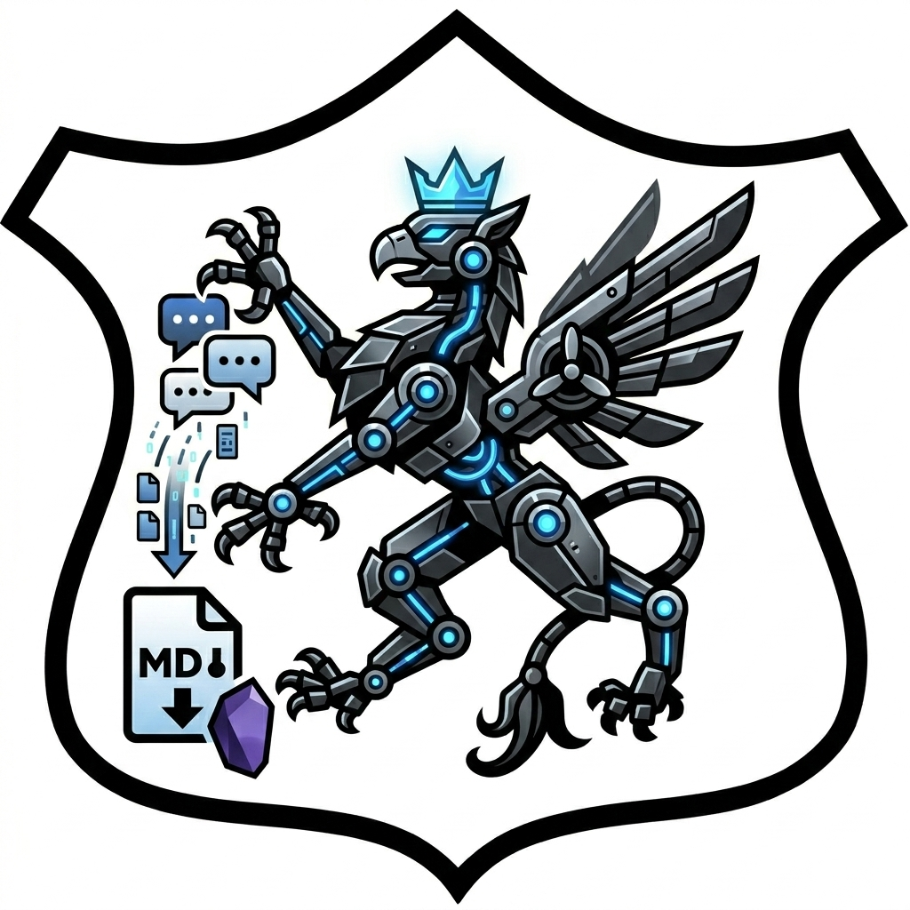

# Robot Therapist Transcriber by Kashub [~]o

> Send your AI conversations into Obsidian, locally.

A small, local Chrome extension that exports the currently-open ChatGPT,
Gemini, or Claude conversation as a Markdown file with YAML frontmatter,
ready to drop into your Obsidian vault. The extension auto-detects which
AI you're talking to from the active tab's URL, then transcribes the
session like a stenographer in the corner of a robot therapy appointment.

No third-party servers. No analytics. No auto-updates. Just a folder of
plain JavaScript that runs entirely on your machine.

## Features

- **One-click export** from the toolbar — auto-detects the provider
  (ChatGPT, Gemini, Claude) from the active tab's URL.
- **Markdown output with YAML frontmatter** (`source`, `title`, `url`,
  `exported`, `messages`).
- **Inline images embedded as Obsidian wikilinks** (`![[…]]`) at the right
  position in the conversation, with the correct file extension derived
  from the actual MIME type.
- **Handles `blob:` URLs** (Gemini's generated images) by fetching the
  bytes from the page context and converting to a data URL the downloader
  accepts.
- **Falls back to direct `chrome.downloads` for cookie-gated CDN assets**
  (Google's `lh3.googleusercontent.com` redirect targets, etc.) where
  page-context fetch is blocked by CORS.
- **Records orphaned and failed attachments as HTML comments in the
  markdown** so you can find and resolve them later (search your vault
  for `<!-- ` to surface them all).
- **Toolbar badge feedback**: `OK` (green) / `ERR` (red) /
  `?` (grey for unsupported sites). Brief, fades after a couple of
  seconds.
- **About popup**: right-click the extension icon → "About Robot
  Therapist Transcriber".

## Install

1. Chrome → `chrome://extensions`.
2. Toggle **Developer mode** (top-right corner).
3. Click **Load unpacked**.
4. Select this folder (the one containing `manifest.json`).
5. Pin the extension to the toolbar (puzzle-piece icon → pin).

## Usage

1. Open a chat at `chatgpt.com`, `gemini.google.com`, or `claude.ai`.
2. **Scroll to the very top of the conversation, then back to the bottom.**
   Long chats are virtualised and images are lazy-loaded; this ensures
   everything is in the DOM before extraction.
3. Click this extension's icon in your Chrome toolbar (the one with the
   logo above).
4. A `.md` file downloads, along with the chat's images.
5. Drop the `.md` and any image files into the same folder of your
   Obsidian vault — wikilinks resolve and images render inline.

### Toolbar badge

| Badge | Meaning |
| --- | --- |
| `OK` (green) | Export succeeded — see DevTools console for filename |
| `ERR` (red) | Selectors didn't match (DOM changed) or injection failed |
| `?` (grey) | Active tab isn't a supported provider |

For details on a failed run, open DevTools (F12) on the chat tab and look
for `[ai-export]` lines.

### Reload after editing

`chrome://extensions` → click the reload icon on the **Robot Therapist
Transcriber** card. No build step — the source is plain JavaScript.

## Layout

```
extension/
  manifest.json              MV3 manifest
  background.js              Service worker; routes click → provider, About menu
  about.html                 About popup (right-click → About …)
  logo.png                   Toolbar / extensions-page icon
  README.md                  You are here
  providers/
    shared.js                htmlToMd, sanitize, buildDocument, downloadAsset
    chatgpt.js               ChatGPT-specific selectors and title logic
    gemini.js                Gemini-specific selectors and title logic
    claude.js                Claude-specific selectors and title logic
```

## How it works

When you click the toolbar icon, the service worker reads the active tab's
URL, picks the matching provider script, and injects `providers/shared.js`
followed by `providers/<provider>.js` into the page. The provider walks
the conversation DOM, builds Markdown via a tiny hand-rolled HTML→MD
converter, downloads attachments through `chrome.downloads`, and writes
the `.md` file.

For attachments, the script first tries fetching them in the page context
so it can read the real MIME type and set the right file extension
upfront. If page-context fetch fails (CORS or auth), it falls back to
`chrome.downloads.download(originalUrl)`, which uses Chrome's network
stack and the user's cookie jar, then reads the actual saved filename
back via `chrome.downloads.search` once the download completes.

Re-running an export uses `conflictAction: "overwrite"` so files refresh
in place rather than spawning `(1)`, `(2)` clones in your Downloads
folder.

## Limitations

- **Selectors break when AI providers reshuffle their DOMs.** When that
  happens the script logs an error in DevTools and the badge goes red.
  Inspect the page, update selectors in `providers/<provider>.js`,
  reload. The script does not produce silent garbage when selectors
  miss — it fails loud.
- **ChatGPT user-uploaded files don't have download URLs in the DOM.**
  ChatGPT serves them via an authenticated backend API. The exporter
  records each file as a wikilink with a comment to save it manually
  from ChatGPT.
- **ChatGPT files expire.** OpenAI purges uploaded files after a
  retention period (around 30 days for personal tiers). Once expired,
  even the manual workflow can't recover them. Export soon after
  uploading.
- **Lazy-loaded images need to scroll into view.** The script catches
  `data-src` and `srcset` fallbacks, but only for elements actually
  loaded into the DOM. Scroll the whole chat before clicking export.
- **Long chats are virtualised.** Scroll to the top first, then back
  down, so every turn is loaded.
- **Failed downloads are flagged in markdown** with HTML comments like
  `<!-- image failed to download: … -->` so you can find and resolve
  them later.

## Provider quirks

- **ChatGPT**: Files attached via the upload UI never expose a URL in
  the DOM. The markdown gets a wikilink with a comment indicating that
  the user must save manually. Inline images in messages and
  DALL·E-style generations work normally.
- **Gemini**: Generated images use `blob:` URLs scoped to the page
  (handled). User-uploaded images on `lh3.googleusercontent.com`
  redirect through a cookie-gated CDN; those go through the
  direct-download fallback path.
- **Claude**: Tries `data-testid` hooks first
  (`user-message` / `assistant-message`), falls back to
  `font-user-message` / `font-claude-message` class names that have
  survived several redesigns.

## Disclaimer

**This extension was fully vibe-coded.** Built end-to-end through a
single iterative session of trying things on real chats and patching
what broke. There is no test suite. There is no formal spec. There is
no review process. Selectors are written against whatever DOM the
provider happened to ship at the time of writing.

**Use at your own risk.** In particular:

- The extension reads and writes data on `chatgpt.com`,
  `chat.openai.com`, `gemini.google.com`, and `claude.ai`. It has the
  `downloads` permission. The source is in this folder — read it before
  trusting it.
- Selectors will break when providers redesign. The script will
  badge red and log loudly, but exports may be incomplete until you
  patch. There are no version updates pushed to you; you decide what
  changes when.
- File downloads use `conflictAction: "overwrite"` — re-running on the
  same chat refreshes the same files in place. Don't run it on a chat
  whose attachments you've already manually edited unless you mean it.
- Attachments may be expired server-side (especially on ChatGPT) and
  unrecoverable. The exporter does its best and notes the gap.
- No claim is made over the conversations you export, and no
  responsibility is accepted for what you do with the resulting files.

If any of this matters to you, fork the source and audit it. It's small
enough to read end-to-end in one sitting. If none of it matters to you,
enjoy.
